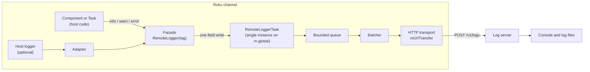
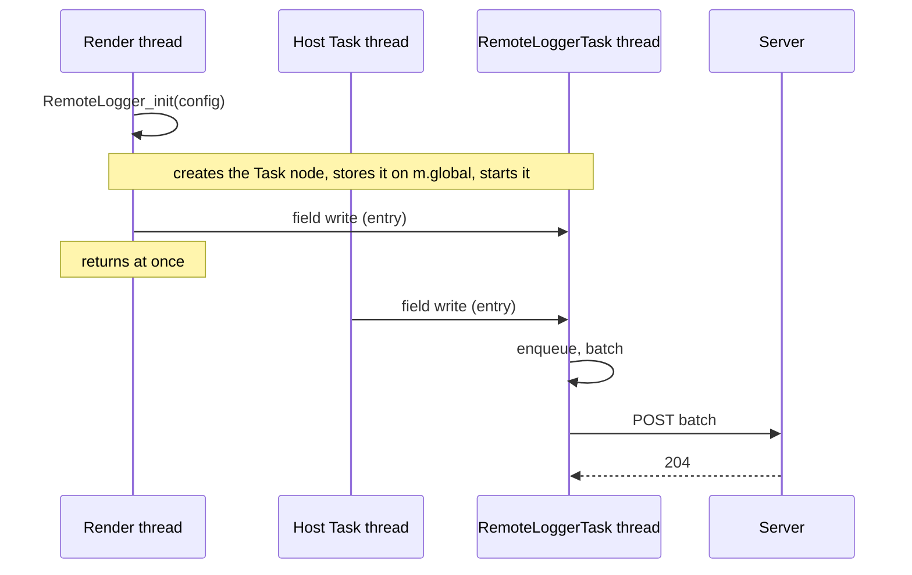

# Architecture

This document describes the target design. The code in the repository today is a proof of concept and does not yet follow it.

## Goals

1. **See logs from builds without a console.** Entries reach a developer's machine within a few seconds.
2. **Fit any channel.** Plain BrightScript or BrighterScript, any build tool, with or without an existing logger.
3. **Stay out of the way.** A log call must never block the render thread, and a disabled logger must cost nothing.
4. **Lose logs before harming the app.** When the network or the server fails, the library drops entries and counts them. It never grows without bound, retries forever or delays the app.

## Design constraints

These come from how real channels are built, and they shape every decision below.

| Constraint | Consequence |
|---|---|
| Many channels are plain BrightScript with no compile step for third-party code | The library is written in plain `.brs`. No classes, namespaces or imports. Names carry a `RemoteLogger_` prefix. |
| Channels vendor code in different ways: copied source, `ropm`, git submodule, component library | The library is a small set of files with no dependencies, so every method works. |
| Each SceneGraph component and each Task has its own scope and its own `m` | There is no shared logger object. Each component builds a light facade; the facades all feed one node. |
| Some host code runs inside a component library, where source functions of the host are not visible | The pipeline is reached through a node on `m.global`, never through shared source functions alone. |
| Host apps already have loggers, with different shapes | The library exposes one sink entry point. Adapters map a host logger onto it. |
| Host apps choose who gets diagnostics through their own flags or remote config | The library takes a plain configuration object. It does not fetch configuration itself. |
| Performance teams measure allocations and rendezvous | See [Performance rules](#performance-rules). |

## Components

### Facade

A small object created per component with `RemoteLogger(tag)`. It holds the tag, the cached level and a reference to the Task node.

- Checks the level first. A filtered call returns before it builds anything.
- Stamps the entry with a timestamp and a sequence number at call time, so the server can restore order.
- Hands the entry to the Task node and returns. It never waits for a result.
- When the library is disabled or was never initialised, every method is a no-op.

### Adapter

Optional glue owned by the host app or supplied as a recipe. It turns the host logger's call into a facade call. See [Integration](INTEGRATION.md). Adapters keep the library free of knowledge about any one app.

### RemoteLoggerTask

One Task node, created by `RemoteLogger_init` and stored on `m.global`. It owns everything slow or stateful:

- **Bounded queue.** A ring buffer with a fixed capacity. When it is full the oldest entries are dropped and a counter goes up. The next batch reports that counter.
- **Batcher.** Sends when the batch reaches its size limit, when the flush interval expires, or at once for an entry at `error` level.
- **Transport.** One `roUrlTransfer` per request, asynchronous with a timeout. On a timeout or a 5xx reply it backs off and retries; on a 4xx reply it drops the batch.
- **Session envelope.** Device model, OS version, channel version and a session id, collected once at start.

The Task loop reads its configuration once at start and keeps working state in locals. It does not read `m.top` fields per entry.

### Log server

Receives batches and makes them readable. Today it is one Python file using only the standard library; it prints each entry and appends it to a file. It stays that small on purpose: a later milestone adds one file per session with a JSON entry per line, and reading is left to `tail`, `grep` and `jq`. Any server that implements [the protocol](PROTOCOL.md) can replace it.

## Threading model

- The render thread owns the Task node, so a write from the render thread is cheap.
- A write from another Task thread to a render-owned node is a rendezvous. This is the main cost risk in the design, and it is why the write strategy is an [open question](#open-questions).
- All network work happens on the logger's own thread.

## Performance rules

A log call on a hot path must stay cheap. These rules are requirements, and milestone M3 verifies them with a profiler.

1. Filter by level before any allocation.
2. Cache the level and the node reference when the facade is created. Do not read configuration per call.
3. One field write per entry at most. No `callFunc`, no field reads, no `observeField` round trip.
4. Do not format on the caller's thread. The facade passes the message and the data object as given; the Task serialises them.
5. Disabled means absent. No Task node is created and facades hold nothing.

## Configuration

The host app passes one object to `RemoteLogger_init`. Where the values come from (a remote flag, the registry, a deep link, a build constant) is the host app's choice.

| Key | Meaning | Default *(planned)* |
|---|---|---|
| `enabled` | Master switch | `false` |
| `endpoint` | Full URL of the server's log route | none; required when enabled |
| `level` | Minimum level for the session: `error`, `warn`, `info`, `debug`, `trace` | `info` |
| `batchSize` | Entries per request | 20 |
| `flushIntervalMs` | Longest wait before a partial batch is sent | 2000 |
| `maxQueue` | Ring buffer capacity | 500 |
| `headers` | Extra HTTP headers, for example an auth token | none |
| `sessionTags` | Free-form labels added to the envelope, for example tester name or build flavour | none |

The level is chosen at launch, not at build time. It reaches the app the same way the endpoint does (a deep link parameter, a registry value, a remote flag), so a tester picks the level for a session without a new build. See [Integration: decide who gets it](INTEGRATION.md#4-decide-who-gets-it).

All values are fixed once `RemoteLogger_init` has run. To log at another level, relaunch with another value.

## Lifecycle

- **Start.** `RemoteLogger_init` runs once on the render thread. Calling it again is a no-op.
- **Suspend and resume.** On channels that support instant resume, the Task flushes on suspend when it can, and must not hold up resume. Nothing in the resume path may wait on the logger.
- **Exit.** The last partial batch is sent on a best-effort basis. Entries still queued at exit are lost; a later milestone keeps a short tail of `error` entries for the next launch.
- **Stop.** The Task watches a cancel field that it reads itself, so the host can stop it without interrupting it mid-request.

## Failure behaviour

| Failure | Behaviour |
|---|---|
| Server unreachable or timeout | Back off, retry the batch a limited number of times, then drop it and count the entries |
| 4xx reply | Drop the batch; do not retry |
| Queue full | Drop the oldest entries and count them |
| Entry too large | Truncate the message and mark the entry as truncated |
| Data object cannot be serialised | Send the entry without the data and mark it |
| Library not initialised | Facade calls do nothing |

Dropped counts travel in the next successful batch, so the reader knows the log has gaps.

## Security

- **Personal data.** The library cannot tell what is sensitive. The host app is responsible for what it logs. A redaction hook is planned in M5.
- **Transport.** The bundled server speaks plain HTTP and is for a trusted local network. HTTPS endpoints work with `SetCertificatesFile` alone; the library does not call `InitClientCertificates`, which Roku has deprecated.
- **Access.** The `headers` option lets a deployment require a token. The bundled server does not check one until M5.
- **Exposure.** The master switch defaults to off. A public build should not be able to turn the logger on without a deliberate act by the host app.

## Open questions

Each is settled by measurement on a device in the milestone named.

1. **Write strategy from Task threads (M1).** Direct write per entry is simplest but costs one rendezvous each time a non-render thread logs. The alternative is a small buffer in the facade that is flushed in groups, which cuts rendezvous but can hold entries back in a quiet component. The default is direct write; buffering becomes an option if profiling shows the need.
2. **Entry hand-off field type (M1).** An `assocarray` field with `alwaysNotify`, or a node child per entry. Decided by copy cost.
3. **Persisted tail (M3).** The registry is small. Whether keeping the last few `error` entries across a crash is worth the space is decided once the size of a typical entry is known.
4. **Capturing system events (later).** Whether to forward `roSystemLog` events (HTTP errors, bandwidth) as entries, or leave that to monitoring vendors.
