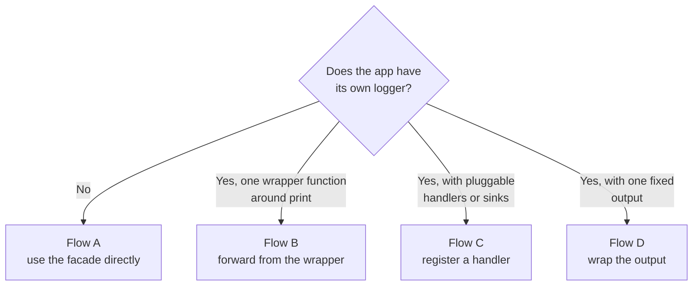
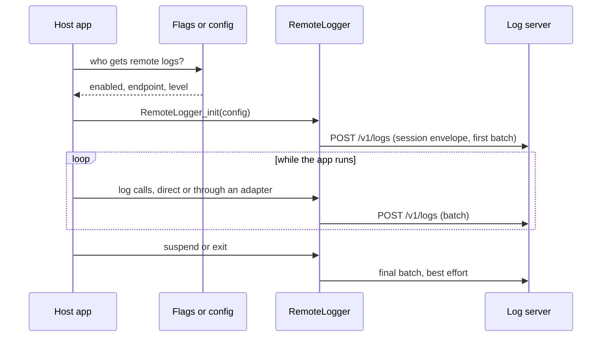

# Integration

How to add the library to a channel and connect it to the logging the channel already has. The API shown is *planned*; it becomes stable at the end of milestone M2.

## The steps in short

1. [Install](#1-install) the files.
2. [Initialise](#2-initialise) once at start-up.
3. [Connect](#3-connect) through the flow that matches the app.
4. [Decide who gets it](#4-decide-who-gets-it).
5. [Verify](#5-verify) on a device.

## 1. Install

The library is a handful of plain `.brs` files and one Task component, with no dependencies. Pick the method the channel already uses for third-party code.

| Method | How |
|---|---|
| Copy | Copy `src/source/` and `src/components/` into the channel. Simplest, and works with any build. |
| `ropm` *(from M2)* | `ropm install roku-remote-logger`. Function and component names get the `ropm` prefix. |
| Git submodule | Add this repository as a submodule and include `src/` in the build's file list. |

Each component that logs must include the facade script in its XML:

```xml
<script type="text/brightscript" uri="pkg:/source/RemoteLogger.brs" />
```

If the channel lints third-party code, exclude the library's folder the same way it excludes other vendored code.

## 2. Initialise

Call `RemoteLogger_init` once, on the render thread, as early as the scene's `init()`. It creates the Task node and stores it on `m.global`.

```brightscript
sub init()
    RemoteLogger_init({
        enabled: true
        endpoint: "http://192.168.1.20:8085/v1/logs"
        level: "debug"
        sessionTags: { tester: "qa-01" }
    })
end sub
```

Entries logged before this call are dropped. If start-up logs matter, initialise before anything else in the scene.

All options are listed in [Architecture: configuration](ARCHITECTURE.md#configuration).

## 3. Connect

Choose one flow. The right one depends on what the app has today.



### Flow A: no logger yet

Use the facade as the app's logger.

```brightscript
sub init()
    m.log = RemoteLogger("PlayerScreen")
end sub

sub onStateChange(event as object)
    m.log.info("state changed", { state: event.getData() })
end sub
```

### Flow B: one wrapper function around `print`

Many apps route every log through a single helper. Forward from inside it, and every existing call site is covered.

```brightscript
sub App_log(message as string, data = invalid as dynamic)
    if m.remoteLog = invalid then m.remoteLog = RemoteLogger("app")
    m.remoteLog.info(message, data)           ' added: runs in every build

    if CreateObject("roAppInfo").isDev()      ' existing gate stays on print only
        print message; data
    end if
end sub
```

Check whether the wrapper is gated on a developer-build test such as `roAppInfo.isDev()`. Such a gate silences exactly the builds this library is for. Keep the gate on `print` and put the remote call outside it, as above.

Two common variations:

- **The wrapper takes several loose arguments** in place of one message. Pass them as the data, in an array, with a fixed message: `m.remoteLog.info("log", [a, b, c])`. The server prints them in order.
- **The wrapper has no levels.** Everything is sent as `info`, so the library's level can only be `info` or off. That is acceptable to start with; add a level argument to the wrapper when the volume becomes a problem.

### Flow C: a logger with pluggable handlers

If the host logger accepts handlers (also called sinks, appenders or transports), write one that forwards to the facade. Call sites and the host logger stay untouched.

```brightscript
function RemoteLogHandler() as object
    return {
        log: RemoteLogger("host")
        emit: function(entry as object)
            m.log.write(entry.levelName, entry.name, entry.message, entry.extra)
        end function
    }
end function
```

`write(level, tag, message, data)` is the single sink entry point; the level methods are shortcuts for it. The handler's method name and the fields of `entry` are whatever the host logger defines; only the body is fixed.

Register it next to the handlers the logger already has:

```brightscript
logger.addHandler(ConsoleLogHandler())    ' existing
logger.addHandler(RemoteLogHandler())     ' added
```

If handlers are registered per logger instance, add the remote handler in the place where the host creates its loggers, usually the logger's constructor, so that every instance gets it.

### Flow D: a logger with one fixed output

Some loggers call a single output object and offer no list. Build an output with the same methods that calls the original and then the facade:

```brightscript
function RemoteLogOutput() as object
    return {
        inner: ConsoleLogOutput()                       ' the host's existing output
        remote: RemoteLogger("host")
        levels: ["", "error", "warn", "info", "debug"]  ' index = the host's numeric level

        handleLog: function(message as string, level as integer, context as string, params as dynamic)
            m.inner.handleLog(message, level, context, params)          ' print as before
            m.remote.write(m.levels[level], context, message, params)   ' and send
        end function

        ' Forward every other method the host logger calls on its output.
        setContext: function(context as string)
            m.inner.setContext(context)
        end function
    }
end function
```

Then give the logger the wrapper in place of the original, in the one place where the logger creates its output:

```brightscript
m.setOutput(RemoteLogOutput())    ' was ConsoleLogOutput()
```

The wrapper must copy the original's method names and signatures exactly, because the logger calls them without checking.

If the logger builds its output internally and offers no way to replace it, that one line is a change to the host logger itself. This is the only flow that may need a change outside the adapter.

### Levels: the host's and the library's

Every app names and orders its levels in its own way. The library does not try to know them. It has five fixed levels, and the adapter translates.

| Host level | Maps to |
|---|---|
| Same name as a library level | That level |
| `verbose`, `fine`, or another name for detailed output | `debug` |
| A level between two library levels | The more verbose of the two |
| A "silent" or "off" level | Nothing; it is a setting, not a level of an entry |
| No levels at all (a plain wrapper) | `info` for everything |

The translation is a lookup in the adapter, a few lines per app. Three schemes cover most host loggers:

| Library level | Host with four levels | Host with the same five | Host with no levels |
|---|---|---|---|
| `error` | `ERROR` | `error` | |
| `warn` | `WARN` | `warn` | |
| `info` | `INFO` | `info` | every call |
| `debug` | `VERBOSE` | `debug` | |
| `trace` | | `trace` | |

- **Numeric host levels:** index an array of library names, as in Flow D.
- **Named host levels that match:** pass the name through, as in Flow C.
- **Named host levels that differ:** use a small lookup object, for example `{ verbose: "debug", fatal: "error" }`.

An unknown level name is sent as `info`, so a mapping mistake shows up in the output and loses nothing.

**Data can be any type.** Host loggers pass an object, an array, a string, a number or `invalid` as the extra argument. The adapter hands it over unchanged; the library accepts all of them and serialises what it can.

There are then **two filters in a row**, and an entry must pass both:

1. The host logger's own level decides whether the adapter is called at all.
2. The library's `level` decides whether the entry is sent.

The first one causes most "nothing arrives" reports. A host logger that is silent outside developer builds never calls the adapter, whatever the library's level is. When remote logging is on, the host app must also raise its own logger's level, normally to the same value it passes to `RemoteLogger_init`.

### Code that runs in a component library

Code loaded as a component library cannot call the host app's source functions, and the host cannot call the library's. Both sides can see `m.global`. Include the facade script inside the component library as well; it finds the Task node on `m.global` that the host app created. Initialise in the host app, not in the component library.

### Logging from Task threads

It works the same way, with one cost to know about: a log call from a Task thread crosses to the render thread. Keep logging out of tight loops in Tasks, or raise the level for them. See [Architecture: open questions](ARCHITECTURE.md#open-questions).

## 4. Decide who gets it

The library has a switch but no opinion on who flips it. Common choices:

| Source | Fits when |
|---|---|
| Build-time constant | Separate beta and public builds |
| Remote flag or experiment | One build, enabled for a list of devices or testers |
| Registry value set by a hidden screen or key sequence | A tester needs to turn it on in the field |
| Deep link parameter | Automated runs and one-off sessions |

The endpoint comes from the same place. For a tester at home, a registry value or a deep link carrying the endpoint avoids a rebuild.

Read the value before `RemoteLogger_init` and pass `enabled: false` when in doubt.

The level travels with the endpoint, from the same source, so a tester chooses both at launch without a new build. With a deep link, for example:

```bash
curl -d '' 'http://<roku-ip>:8060/launch/<channel-id>?remoteLog=http://192.168.1.20:8085/v1/logs&remoteLogLevel=debug'
```

The host app reads both parameters from its launch arguments and passes them on:

```brightscript
RemoteLogger_init({
    enabled: args.remoteLog <> invalid
    endpoint: args.remoteLog
    level: args.remoteLogLevel          ' falls back to "info" when absent
})
```

The parameter names are the host app's choice. To log at another level, relaunch with another value.

**A public build must ignore these parameters.** Anyone on the device's network can send a deep link through ECP, and so could point the channel's logs at a server of their own. Read the parameters only in a beta or QA build, or behind a flag that the public audience never gets.

## 5. Verify

1. Start the server and note the address it prints.
2. Launch the channel with the logger enabled and that address as the endpoint.
3. The server prints a session header, then entries. An entry logged in the scene's `init()` should appear within the flush interval.
4. Disconnect the server for a minute, reconnect, and check that the next batch reports dropped entries instead of the app stalling.

## End-to-end flow



## Running next to a monitoring vendor

The library and a monitoring agent can run together. They share nothing but the network.

- Do not send the same entries to both unless that is the aim. Remote logging is for a developer watching one device; the vendor is for fleet-wide numbers.
- Both use `roUrlTransfer` from their own Tasks. Keep the remote logger's batch size and interval modest on low-end devices.

## Checklist

- [ ] Library files are in the build, and the facade script is included in every component that logs.
- [ ] `RemoteLogger_init` runs once, before the first log that matters.
- [ ] The switch is off in public builds.
- [ ] No developer-build gate sits in front of the remote call.
- [ ] The host logger's own level is raised when remote logging is on.
- [ ] Public builds ignore the launch parameters that enable it.
- [ ] Nothing personal is logged at the enabled level.
- [ ] Entries reach the server from the render thread and from at least one Task.
